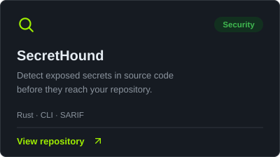
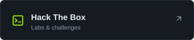

# 0xBrdn

**Cybersecurity · DevSecOps · Software Engineering**

Building security tools, exploring systems and developing practical solutions.

---

## Selected projects

---

## Find me elsewhere

---

## Tech stack

**Programming & Scripting**

&nbsp;
&nbsp;
&nbsp;
&nbsp;
&nbsp;
&nbsp;
&nbsp;
&nbsp;
&nbsp;
&nbsp;

**Web Development**

&nbsp;
&nbsp;
&nbsp;
&nbsp;
&nbsp;

**Infrastructure & Tools**

&nbsp;
&nbsp;

